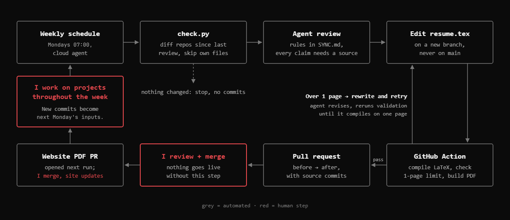

# Résumé

LaTeX source for my résumé (`resume.tex`). The built PDF is `Daniel_Zhang_Resume.pdf`, which is also served at [zhangdz.ca](https://zhangdz.ca).

Using an AI Agent to dynamically update my resume to reflect changes across my GitHub repositories and projects.

More detail on the design and how it was tested: [`docs/PIPELINE.md`](docs/PIPELINE.md).
