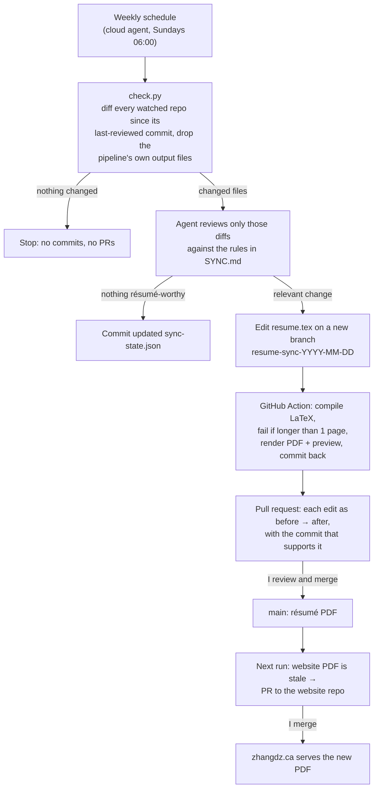

# Résumé sync pipeline

A small CI/CD system that keeps my résumé consistent with what my GitHub repos and portfolio site
actually say. Once a week it checks every project repo for new commits. If something changed that
belongs on a résumé, it drafts the edit, and CI builds and checks the PDF. The edit arrives as a
pull request that cites the commit behind every claim. Nothing reaches the résumé or the website
until I merge it.

## Why

My résumé went out of date in a way that mattered: it described a quadruped controller as a
"custom inverse-kinematics solver with OpenCV obstacle avoidance". The repo said, correctly, that
it's a joint-space trot gait and that computer vision is future work. A reviewer caught the
mismatch. The cause was structural: the résumé, the site and the repos were edited separately,
and nothing checked them against each other. This pipeline makes the repos the source of truth
and the résumé a reviewed output of them.

## Architecture

| Piece | What it is | File |
|---|---|---|
| Change detection | Python script, no AI: diffs each watched repo since the commit last reviewed, minus excluded paths | [`scripts/check.py`](../scripts/check.py) |
| State | Last-reviewed commit per repo, excluded paths, ignored repos | [`sync-state.json`](../sync-state.json) |
| Content rules and procedure | What may be claimed and how, step by step | [`SYNC.md`](../SYNC.md) |
| Build and validation | GitHub Action: reproducible LaTeX build, one-page check, PDF + WebP preview | [`.github/workflows/build.yml`](../.github/workflows/build.yml) |
| Tests | 8 unit tests on throwaway git repos, run in CI | [`tests/test_check.py`](../tests/test_check.py), [`test.yml`](../.github/workflows/test.yml) |
| Orchestration | Scheduled Claude Code routine (cloud agent) that runs the procedure | configured on claude.ai |

## Design decisions

- **Deterministic code decides *whether* to run; the language model only decides *what* to write.**
  Change detection is a plain script with unit tests. The model never runs on an unchanged week,
  which keeps it cheap and predictable.
- **Human in the loop by construction.** The agent can open pull requests but never merges them.
  Every proposed claim must cite a commit, README or page. Contradictions it finds between the site,
  READMEs and code are reported in the PR, not copied into the résumé.
- **Guard rails in CI, not just in instructions.** "One page" is enforced by the build failing, not
  by asking nicely. A LaTeX error or an overflow means no PDF is committed.
- **No self-triggering.** The pipeline writes to its own repo (résumé source, PDF, state) and to the
  website (PDF copy). Those paths are excluded from change detection, so a full cycle of its own
  commits reads as "nothing changed". Its docs and code are *not* excluded: the pipeline is itself a
  project, so changes to it are reviewed like any other.
- **Reproducible builds.** `resume.tex` tells pdfTeX to leave the build date and random file ID out
  of the PDF, so rebuilding unchanged source produces a byte-identical file and no new commit.
- **No force-pushes, ever.** Each new PR gets a fresh dated branch, and updates to an open PR are
  plain fast-forward pushes. A merged PR's branch is never reused.
- **Claude gets credit; the wording is mine.** The agent commits to this repo as Claude, so it shows
  up as a contributor here rather than hiding behind my name. What it drafts is a starting point:
  I reword every bullet in a way that suits me before it stays on the résumé, so it doesn't read
  like AI slop. The agent is told not to revert my wording, only to fix facts that drift.
- **Weekly, early exit.** A daily schedule would mostly confirm nothing changed. Weekly with a
  script-only first step costs close to nothing on quiet weeks.

## Trade-offs and limits

- The agent's judgement of "résumé-worthy" is reviewed by me, not tested. The tests cover the
  deterministic parts: detection, exclusions, page limit and build.
- Only commits pushed to GitHub are seen. Work that only exists locally or offline isn't.
- If GitHub's public API is unreachable from the cloud runner, new repos are found through the
  GitHub integration instead (a fallback, noted in `SYNC.md`).
- While a website PDF PR is open and unmerged, each weekly run sees the stale PDF and does a short
  check (about a minute) before concluding the open PR already covers it.

## Verification

All tests ran on 2026-10-31/11-01 against the real repos.

| Test | How | Result |
|---|---|---|
| Change detection | 8 unit tests on throwaway git repos (project change, a full cycle of the pipeline's own commits, its own docs changing, stale website PDF, unknown commit, new/forked/ignored repos, API down) | 8/8 pass locally and in GitHub Actions |
| Page limit | Pushed a résumé padded to two pages to a test branch | Build failed with "Résumé is 2 pages; it must be 1"; nothing committed |
| Broken LaTeX | (accidental) a test file with a stray control character | Compile failed; nothing committed |
| Reproducible PDF | Built `main` twice with no source change | **Failed first**: the timestamp setting never reached LaTeX inside the build container, so the second build committed a different PDF. Fixed in `resume.tex`; the rebuild then logged "Nothing changed." |
| End-to-end | Planted the old false quadruped claim on a test branch, rewound the state, ran the agent | In 186 s it detected the quadruped README change, replaced the claim with what the repo supports (including the README's measured 0.11 m/s walking speed), removed hardware part numbers nothing in the repo backs up, opened a PR citing commit `3c259d2`, and the build passed at one page. Closed unmerged |
| No loop | Ran the real weekly job right after | Found only the stale website PDF, opened one website PR, made no résumé or state commits (58 s) |

Bugs the tests caught, all fixed: commits authored as the AI instead of me (since 2026-11-01
that's deliberate in this repo, see Design decisions); reuse of a merged PR's
branch (would have needed a force-push, which was blocked); an attribution footer added by the PR
tool; and the non-reproducible PDF above.

**Not yet shown:** how it behaves over months of real changes. The numbers above come from one day
of deliberate tests, not from a long track record.

## What changed in practice

Before: edit LaTeX, export the PDF, copy it into the website repo, regenerate the preview image,
update the "updated" date, push, and remember to cross-check every repo by hand (I didn't, which
is how the false claim survived). Now: review and merge up to two pull requests, each with sources.
